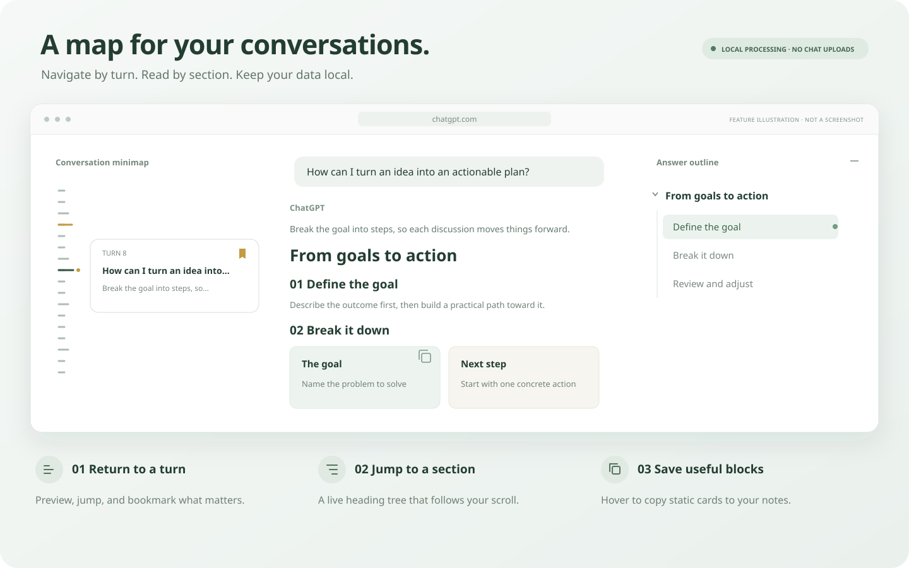

<div align="center">
  
  <h1>ChatGPT Conversation Map</h1>
  <p>
    <a href="https://github.com/Owenwoow/ChatGPT-Conversation-Map/releases/latest"></a>
    <a href="https://github.com/Owenwoow/ChatGPT-Conversation-Map/releases"></a>
    <a href="https://github.com/Owenwoow/ChatGPT-Conversation-Map/actions/workflows/ci-release.yml"></a>
    <a href="manifest.json"></a>
    <a href="LICENSE"></a>
  </p>
  <p><strong>Find your way through long conversations.</strong></p>
  <p>Return to a question on the left. Jump to a section on the right. Spend less time scrolling.</p>
  <p>Chrome / Edge · Manifest V3 · Vanilla JavaScript · Local processing</p>
  <p><a href="README.md">简体中文</a> · <strong>English</strong></p>
  <p><a href="#installation">Quick start</a> · <a href="#features">Features</a> · <a href="#settings">Settings</a> · <a href="https://github.com/Owenwoow/ChatGPT-Conversation-Map/releases">Download</a></p>
</div>



<p align="center"><sub>Feature illustration with sample content. The actual layout adapts to the ChatGPT page and available window space.</sub></p>

## Features

| What you want to do | How Conversation Map helps |
| --- | --- |
| Find an earlier question and answer. | The **conversation minimap** displays one tick per turn. Hover or focus a tick to preview an excerpt, then click to jump. Scroll the minimap in long chats. |
| Return to an important turn later. | Add or remove **bookmarks** in the preview. Bookmarks for saved conversations stay on your device and survive page reloads. |
| Read a specific section of a long answer. | The **hierarchical answer outline** recognizes H1–H6 headings, supports section jumps, highlights the current heading, and lets you collapse subtrees or all top-level subtrees at once. |
| Follow an answer as it is generated. | **Live updates** add headings during generation. Scrolling keeps the current turn and heading in sync; selecting another turn switches its outline. |
| Keep the reading area comfortable. | The **adaptive layout** sizes the outline to available space. Optional **immersive mode** closes the ChatGPT sidebar after each successfully sent message. |
| Save a card or grid to your notes. | **Block copying** adds a copy icon to supported static cards and grids, preserving layout, colors, and editable text where possible for pasting into Obsidian. |

Supports light and dark appearance, keyboard focus and controls, Escape to collapse, and the system's reduced-motion preference. Outline updates preserve its scroll position and focus. New turns preserve minimap focus, while open previews update with the answer.

## Installation

Works with **Chrome and Edge** browsers that support Manifest V3 extensions. No build, API key, or extra account is required.

1. Download a ZIP from [GitHub Releases](https://github.com/Owenwoow/ChatGPT-Conversation-Map/releases) and extract it to a permanent folder, or download or clone this repository.
2. Open `chrome://extensions` in Chrome, or `edge://extensions` in Edge.
3. Enable **Developer mode**, select **Load unpacked**, and choose the folder containing `manifest.json`.
4. Open or refresh [ChatGPT](https://chatgpt.com/) and visit a multi-turn conversation longer than one screen. Pin the extension icon for easy access to settings.

> **Updating:** Replace the files in the folder actually loaded by your browser, reload the extension on the extensions page, then refresh existing ChatGPT tabs. Check the extension details for its loaded source if you are unsure which folder is in use.

## Settings

Click the extension icon in the browser toolbar. Changes save automatically and take effect immediately.

| Setting | Default | What it does |
| --- | --- | --- |
| Conversation map | On | Navigate earlier questions and answers on the left side of the page. |
| Response outline | On | Browse headings in the current answer on the right side. |
| Outline width | Auto | Choose Auto, Narrow (240 px), Medium (320 px), or Wide (400 px). The outline narrows when space is limited. |
| Auto-expand while generating | On | Automatically open the outline as headings appear in a new answer. |
| Auto-collapse | Off | Close an automatically opened outline when the pointer or focus leaves it. Manually opened outlines stay open. |
| Immersive mode | Off | Close the ChatGPT sidebar after each successfully sent message. You can reopen it manually; opening, switching, or reading a chat does not trigger this behavior. |
| Copy content blocks | On | Show a copy button when hovering over static diagrams or cards. Turning it off hides the button immediately. |

The **settings page follows the browser's interface language**: Chinese uses Simplified Chinese; other languages use English. Documentation is available in both languages. Navigation labels on the ChatGPT page currently remain in Chinese.

## Usage tips

### Navigate turns and bookmark important ones

The minimap needs **at least two turns** and enough page content to scroll. Hover a tick and use the bookmark button in its preview, or focus a tick and press Tab to reach the bookmark button.

- **Long gold tick:** a bookmarked turn.
- **Long bright tick:** the current turn. A gold dot appears alongside it when that turn is also bookmarked.
- Bookmarks require a saved conversation and stable turn identifiers. Temporary chats cannot currently be bookmarked.

### Browse answer sections

The outline appears only when the answer contains headings. Click a heading to jump to it, or its arrow to collapse or expand its subtree. Hover a long heading to see its full text. The double-arrow button collapses all top-level subtrees; click again to expand them. Individual deeper collapse states are preserved.

Code, hidden content, headings inside bordered cards, and numeric display components are excluded. When space is limited, use the outline button to open an overlay. The minimap hides when there is too little space on the left, keeping the answer unobstructed.

When a ChatGPT link preview opens on the right, the outline moves out of its way or collapses to a button, then restores its previous state when the preview closes. Preview content is excluded from turns and headings. Manually opened outlines stay open until closed manually or with Escape. Switching conversations re-detects the current chat; expansion state is not persisted.

### Copy static blocks

Hover a supported static card or grid in an answer and click its top-right copy icon. A green check briefly confirms success. Paste into **Obsidian's source mode**, then switch to reading view.

Block copying is intended for static content. Interactive forms, images, and canvases are not copied. Scripts, page class names, and external style dependencies are removed; themes, fonts, and complex SVGs may look different after pasting.

## Privacy and permissions

**Chat content is processed locally in the current tab and is never uploaded by the extension.**

| Data or permission | Purpose and storage |
| --- | --- |
| `https://chatgpt.com/*` | The extension runs only on this site and reads loaded questions, answers, and headings to build navigation. |
| `storage` | Saves settings and bookmarks locally. Bookmarks contain conversation and turn identifiers, not chat text. |
| Chat text, headings, and turn history | Kept only in the current tab's memory and discarded on reload. |

The extension does not request external services, generate AI summaries, or access private ChatGPT APIs. Its interface uses Shadow DOM, and chat text is rendered through `textContent`. There are no runtime dependencies or remote scripts.

## Compatibility and limitations

- **Unloaded history must be visited first.** ChatGPT may unload messages far from the viewport. The extension retains turns already observed in the current conversation and tries to scroll and wait for unloaded messages when jumping. History never loaded on the page must first be reached by scrolling upward. If a jump fails, the extension shows a message and restores the previous scroll position.
- **Page changes may affect compatibility.** ChatGPT's structure, staged features, and virtualization behavior can change. The project includes simulated-page and real-extension-loading tests, but cannot cover every live scenario.
- **If navigation is missing,** refresh the page, check that the extension is enabled, and confirm there is enough window space, enough conversation turns, and headings in the answer.

## Development and testing

The extension source loads directly with **no compilation step**. Development checks use Node.js and npm. Packaging requires PowerShell; browser tests require Playwright's Chromium.

```powershell
npm install
npx playwright install chromium
```

| Command | Purpose |
| --- | --- |
| `npm test` | Run Node.js unit tests. |
| `npm run test:browser` | Test navigation, scrolling, responsive layout, and interaction on simulated pages. |
| `npm run test:extension` | Load the extension in a separate temporary Chromium profile and test injection and settings. |
| `npm run package` | Create a ZIP in `release/` using the version in `manifest.json`. |

For development, use a separate Chrome profile and load the repository root. After editing, reload the extension and refresh ChatGPT tabs; there is no need to package or copy files for each change.

| Directory / file | Responsibility |
| --- | --- |
| [`src/adapter.js`](src/adapter.js) | Page adaptation and content detection. |
| [`src/model.js`](src/model.js) | Conversation history and heading trees. |
| [`src/content.js`](src/content.js) | Navigation interface, synchronization, and jumps. |
| [`src/block-export.js`](src/block-export.js) | Static block detection and copying. |
| [`popup/`](popup/) | Settings interface and language adaptation. |
| [`tests/`](tests/) | Unit tests, fixtures, and extension tests. |

Release ZIPs include the files required to run the extension and `LICENSE`. `release/`, test output, and dependency directories are excluded from version control.

## License

This project is licensed under the [MIT License](LICENSE). Use, modification, distribution, and commercial use are permitted. Copies or substantial portions of the software must retain the copyright and license notices. The software is provided as is, without warranty.
