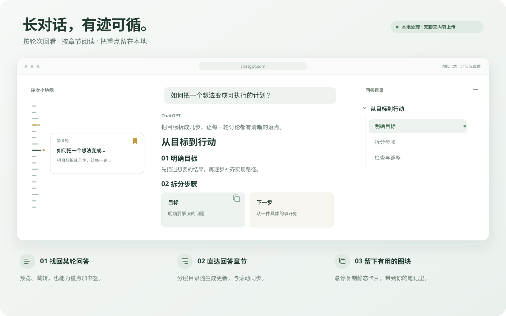

<div align="center">
  
  <h1>ChatGPT 对话地图</h1>
  <p>
    <a href="https://github.com/Owenwoow/ChatGPT-Conversation-Map/releases/latest"></a>
    <a href="https://github.com/Owenwoow/ChatGPT-Conversation-Map/releases"></a>
    <a href="https://github.com/Owenwoow/ChatGPT-Conversation-Map/actions/workflows/ci-release.yml"></a>
    <a href="manifest.json"></a>
    <a href="LICENSE"></a>
  </p>
  <p><strong>长对话，也能轻松找到方向。</strong></p>
  <p>左侧回到某轮提问，右侧直达回答章节。把滚动查找变成有迹可循的阅读。</p>
  <p>Chrome / Edge · Manifest V3 · 原生 JavaScript · 仅本地处理</p>
  <p><strong>简体中文</strong> · <a href="README.en.md">English</a></p>
  <p><a href="#安装">快速安装</a> · <a href="#功能">功能介绍</a> · <a href="#设置">设置说明</a> · <a href="https://github.com/Owenwoow/ChatGPT-Conversation-Map/releases">下载发行包</a></p>
</div>



<p align="center"><sub>功能示意图，使用示例内容说明导航方式；实际布局随 ChatGPT 页面和窗口宽度变化。</sub></p>

## 功能

| 阅读时遇到的问题 | 对话地图如何帮助你 |
| --- | --- |
| “之前那轮问答在哪里？” | **对话小地图**按问答轮次显示刻度，悬停或键盘聚焦查看摘录，点击跳转；长对话可滚动浏览刻度。 |
| “这轮很重要，稍后还要回来。” | **轮次书签**可在预览中添加或取消，已保存会话的标记保存在本地，刷新后仍可找到。 |
| “回答很长，只想看某个章节。” | **分层回答目录**识别 H1–H6 标题，支持章节跳转、当前标题高亮、折叠子目录和一键折叠第一层标题的子目录。 |
| “回答还在生成，目录能跟上吗？” | **生成时同步**动态更新标题；滚动页面同步当前轮次和标题，切换轮次也会切换对应目录。 |
| “想专心读，不想反复整理界面。” | **自适应布局与沉浸模式**按可用空间调整目录；可选择每次成功发送消息后自动收起 ChatGPT 侧边栏。 |
| “回答里的卡片，想带到笔记里。” | **图块复制**在静态卡片或网格右上角提供复制图标，尽量保留布局、颜色和可编辑文字，便于粘贴到 Obsidian。 |

支持浅色与深色外观、键盘聚焦操作、Escape 收起和系统“减少动态效果”偏好。目录随生成更新时保留当前滚动位置和焦点；新增轮次时，小地图保留当前焦点，打开的预览随回答更新。

## 安装

支持加载 Manifest V3 扩展的 **Chrome 和 Edge**。源码无需构建，也不需要 API Key 或额外账号。

1. 从 [GitHub Releases](https://github.com/Owenwoow/ChatGPT-Conversation-Map/releases) 下载 ZIP，解压到固定目录；也可下载或克隆本仓库。
2. 在 Chrome 打开 `chrome://extensions`，或在 Edge 打开 `edge://extensions`。
3. 开启**开发者模式**，点击**加载已解压的扩展程序**，选择包含 `manifest.json` 的目录。
4. 打开或刷新 [ChatGPT](https://chatgpt.com/)，进入一段超过一屏的多轮对话。建议固定扩展图标，方便调整设置。

> **更新扩展：**替换实际加载目录中的文件，在扩展管理页重新加载扩展，再刷新已有的 ChatGPT 标签页。若不确定加载目录，可在扩展详情中查看“加载来源”。

## 设置

点击浏览器工具栏中的扩展图标即可调整，设置自动保存并即时生效。

| 设置 | 默认值 | 作用 |
| --- | --- | --- |
| 对话小地图 | 开启 | 在页面左侧定位历史问答轮次。 |
| 回答目录 | 开启 | 在页面右侧浏览当前回答的标题结构。 |
| 目录宽度 | 自动 | 可选自动、窄（240 px）、中（320 px）、宽（400 px）；空间不足时会自动收窄。 |
| 生成时自动展开 | 开启 | 随新回答的标题出现自动展开目录。 |
| 自动收起 | 关闭 | 自动展开的目录在鼠标或焦点离开后收起；手动展开的目录保持打开。 |
| 沉浸模式 | 关闭 | 每次成功发送消息后收起 ChatGPT 侧边栏，之后仍可手动展开；仅打开、切换或阅读会话不会触发。 |
| 图块复制 | 开启 | 悬停静态图表或卡片时显示复制按钮；关闭后隐藏入口，即时生效。 |

**设置页语言**跟随浏览器界面语言：中文使用简体中文，其他语言使用英文。本仓库提供中英文说明；聊天页面上的导航提示目前仍为中文。

## 使用提示

### 找回问答与标记重点

小地图需要**至少两轮对话**和足够的页面滚动空间。悬停左侧刻度，在预览中点击书签即可标记或取消标记；也可聚焦刻度后按 Tab 进入书签按钮。

- **金色长刻度**：已标记的轮次。
- **亮色长刻度**：当前轮次；同时已标记时，刻度旁显示金点。
- 标记只在已保存且能稳定识别的会话和轮次上可用，临时会话暂不可标记。

### 浏览回答章节

回答包含标题时才会显示目录。点击标题定位正文，点击旁边的箭头折叠或展开子目录；长标题可悬停查看全文。顶部双箭头按钮可一次收起所有第一层标题的子目录，再次点击重新展开，保留更深层的单独折叠状态。

目录会排除代码、隐藏内容、带边框的卡片标题和数字展示组件。页面空间不足时，可通过按钮手动打开目录浮层；左侧空间不足时，小地图自动隐藏，避免遮挡正文。

打开 ChatGPT 右侧链接预览时，目录会避开预览，必要时收为按钮；关闭预览后恢复原来的展开或收起状态。预览中的内容不会计入轮次或目录。手动展开的目录保持打开，直到手动收起或按 Escape；切换会话时会重新识别当前会话，展开状态不持久保存。

### 复制静态图块

将鼠标移到回答中的静态卡片或网格，点击右上角复制图标；成功后图标短暂变为绿色对勾。在 **Obsidian 源码模式**中粘贴，再切换阅读视图查看。

图块复制针对静态内容，不复制交互表单、图片或画布。复制内容会去除脚本、网页类名和外部样式依赖；主题、字体和复杂 SVG 可能存在显示差异。

## 隐私与权限

**聊天内容只在当前标签页本地处理，不上传。**

| 内容或权限 | 用途与保存范围 |
| --- | --- |
| `https://chatgpt.com/*` | 扩展仅在此站点运行，读取页面中已加载的问答和标题以生成导航。 |
| `storage` | 在本机保存设置与轮次标记；标记只包含会话及轮次标识，不包含聊天文本。 |
| 聊天文本、标题和轮次记录 | 仅保存在当前标签页内存中，刷新后不保留。 |

扩展不请求外部服务、不调用 AI 摘要、不访问 ChatGPT 私有接口。界面使用 Shadow DOM，聊天文本通过 `textContent` 渲染；没有运行时依赖或远程脚本。

## 兼容性与限制

- **未加载的历史需要先浏览。** ChatGPT 可能卸载长对话中远离视口的消息。扩展保留当前会话中已观察到的轮次，跳转时尝试滚动并等待页面重新加载；从未加载过的历史，需要先向上浏览后才能列出。定位失败时会提示并恢复原来的滚动位置。
- **页面变化可能影响适配。** ChatGPT 的页面结构、灰度功能和虚拟化行为可能变化。项目提供模拟页面与真实扩展加载的自动化测试，但无法覆盖所有线上场景。
- **导航没有出现时，**先刷新页面、确认扩展已启用，并检查窗口空间、对话轮次和回答标题是否满足显示条件。

## 开发与测试

扩展源码可直接加载，**不需要编译**。开发检查需要 Node.js 与 npm；打包需要 PowerShell，浏览器测试需要 Playwright 的 Chromium。

```powershell
npm install
npx playwright install chromium
```

| 命令 | 用途 |
| --- | --- |
| `npm test` | 运行 Node.js 单元测试。 |
| `npm run test:browser` | 使用模拟页面验证导航、滚动、响应式布局和交互。 |
| `npm run test:extension` | 使用独立临时 Chromium 档案加载扩展，验证注入和设置。 |
| `npm run package` | 按 `manifest.json` 的版本号在 `release/` 生成 ZIP。 |

开发时建议使用独立 Chrome 用户档案，直接加载仓库根目录。修改后重新加载扩展并刷新 ChatGPT 标签页，无需反复打包或复制文件。

| 目录 / 文件 | 职责 |
| --- | --- |
| [`src/adapter.js`](src/adapter.js) | 页面结构适配与内容识别。 |
| [`src/model.js`](src/model.js) | 会话历史与标题树。 |
| [`src/content.js`](src/content.js) | 导航界面、同步与跳转。 |
| [`src/block-export.js`](src/block-export.js) | 静态图块识别与复制。 |
| [`popup/`](popup/) | 设置界面与语言适配。 |
| [`tests/`](tests/) | 单元测试、模拟页面及扩展测试。 |

发行 ZIP 包含运行必需的文件及 `LICENSE`。`release/`、测试产物和依赖目录不纳入版本控制。

## 许可证

本项目采用 [MIT 许可证](LICENSE)。允许使用、修改、分发和商业使用，分发副本或主要代码时须保留版权声明和许可声明。软件按原样提供，不附带任何担保。
